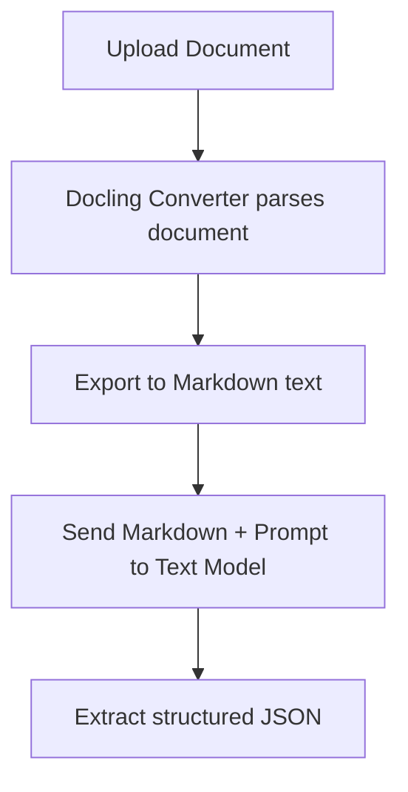

# Invoice & Document Extractor Suite 📄🤖

[](https://github.com/hoangduc102/invoice_extractor/actions/workflows/ci.yml)

A comprehensive suite of Streamlit web applications for extracting structured data from invoices and general documents (PDFs and images) using **LangChain**, **Ollama**, **LangGraph**, and **Docling**.

---

## 📋 Overview

This repository provides a collection of interactive applications designed to demonstrate different architectures for document processing. Whether you want a simple linear extraction workflow, a self-correcting agent that validates its own output, or a schema-configurable extractor that lets you define custom fields on-the-fly, you will find a suitable tool in this suite.

All applications run locally using **Ollama** for privacy and offline capability, supporting both multimodal vision models and text-based parsing.

---

## 🚀 Applications in the Suite

| Application File | Purpose & Focus | LLM Input Type | Key Tech | Unique Features |
| :--- | :--- | :--- | :--- | :--- |
| **`invoice_extractor.py`** *(Main)* | **Self-Correcting Invoice Extractor** | Multimodal (Vision) | LangGraph, ChatOllama | **Self-correction (retries)** when critical fields (Total, Vendor, Date, Inv #) are missing; metrics cards; extraction history stored in the shared database (same table as the REST API). |
| **`extractor_app.py`** | **General Document Extractor** | Text or Multimodal | Docling, ChatOllama | **Dynamic schema editor** (edit & save fields to `field_schema.json`); supports Docling markdown rendering or Multimodal vision; **CSV export**. |
| **`general_app_v2.py`** | **LangGraph General Extractor** | Text or Multimodal | LangGraph, Docling, ChatOllama | Refactored LangGraph implementation of the schema-configurable extractor (`extractor_app.py`). |
| **`docling_app.py`** | **Docling/Multimodal Invoice Extractor** | Text or Multimodal | LangGraph, Docling, ChatOllama | LangGraph-based invoice extractor comparing text-based parsing via Docling vs. vision-based parsing. |
| **`app.py`** | **Basic Invoice Extractor** | Text (PyPDF) or Multimodal | LangGraph, PyPDF, ChatOllama | Basic linear LangGraph pipeline (load -> extract) using `PyPDF` for text parsing. |

---

## 🛠️ Prerequisites

Before running any application, ensure you have the following installed on your system:

### 1. Python 3.12 or later
Check your version with `python --version`.

### 2. A vision LLM: local Ollama **or** a cloud API
The main pipeline (`invoice_extractor.py`, the REST API, the evaluation) works with any of these, chosen by
`LLM_PROVIDER` in `.env` (see [Choosing the LLM backend](#-choosing-the-llm-backend)):

| `LLM_PROVIDER` | Needs | Default model | Cost |
| :--- | :--- | :--- | :--- |
| `ollama` (default) | Ollama installed + a pulled vision model (~4–5 GB) | `llava` | Free, fully local |
| `gemini` | `GOOGLE_API_KEY` | `gemini-3.5-flash-lite` | Free tier available |
| `openai` | `OPENAI_API_KEY` | `gpt-4.1-mini` | Pay per use |
| `anthropic` | `ANTHROPIC_API_KEY` | `claude-haiku-5-5` | Pay per use |

The other Streamlit apps (`extractor_app.py`, `general_app_v2.py`, `docling_app.py`, `app.py`) still use Ollama only.

**Ollama setup.** Download and install Ollama from [ollama.com](https://ollama.com).
On Windows you can keep it off a full C: drive: install with `OllamaSetup.exe /DIR="D:\Ollama"` and set
`OLLAMA_MODELS=D:\Ollama\models` so models are stored there too.

Start the Ollama service (`ollama serve`) and pull the models used by the applications:
```bash
# Pull a multimodal vision model (used by invoice_extractor.py & multimodal modes)
ollama pull llava
# or other vision models like
ollama pull qwen3-vl:2b
ollama pull gemma3:4b

# Pull a text-only model (used by Docling / text modes)
ollama pull ministral-3:3b
# or
ollama pull llama3.2
```

### 3. PDF rendering: nothing to install
PDF pages are rendered to images with [`pypdfium2`](https://github.com/pypdfium2-team/pypdfium2) (`core/pdf.py`),
which bundles Google's PDFium inside the pip wheel. There is no Poppler or other system package to install,
on Windows, macOS, Linux or in Docker.

---

## 📦 Installation

1. **Clone the repository**:
   ```bash
   git clone https://github.com/hoangduc102/invoice_extractor.git
   cd invoice_extractor
   ```

2. **Install the dependencies**:
   ```bash
   pip install -r requirements.txt
   ```

---

## 🔧 Configuration

### Environment Variables
Copy `.env.example` to `.env` in the root of the project:
```bash
cp .env.example .env
```

Edit the `.env` file:
```ini
LLM_PROVIDER=ollama            # ollama | gemini | openai | anthropic
# LLM_MODEL=                   # optional, overrides the provider's default model
GOOGLE_API_KEY=                # only for the provider you use
OLLAMA_BASE_URL=http://localhost:11434
DATABASE_URL=sqlite:///./invoices.db
```

### 🔀 Choosing the LLM backend
`core/llm.py` builds the chat model from `LLM_PROVIDER` / `LLM_MODEL`. Every backend receives the same
LangChain message (prompt + base64 image), so the LangGraph self-correction pipeline is identical for all of them.
Cloud clients use `temperature=0`, a 120 s timeout and 3 automatic retries (useful against free-tier rate limits).

Example: run everything on the Gemini free tier, with nothing to download:
```ini
LLM_PROVIDER=gemini
GOOGLE_API_KEY=your-key-from-aistudio.google.com
```
The API reports the active backend at `GET /config`; the web UI and Streamlit sidebar show it too.
A missing key or package returns `503` with the exact variable or `pip install` command to fix it.

> **Privacy:** with a cloud provider, invoice images are sent to that provider. Google states that free-tier
> Gemini content may be used to improve its products. Use `ollama` for real or confidential documents.

---

## 🎯 Running the Applications

Start any app using `streamlit run <filename>`.

### 1. Self-Correcting Invoice Extractor (Main App)
Features UI cards, validation checking, extraction history in the shared database, and self-correction cycles.
```bash
streamlit run invoice_extractor.py
```

### 2. General Document Extractor (Customizable Schema)
Allows you to define what fields to extract inside the UI and export results to CSV.
```bash
streamlit run extractor_app.py
```

### 3. LangGraph General Extractor
Same custom schema flexibility, powered by a LangGraph node-based pipeline.
```bash
streamlit run general_app_v2.py
```

### 4. Docling/Multimodal Invoice Extractor
Uses LangGraph to compare Docling markdown extraction vs. Multimodal vision models.
```bash
streamlit run docling_app.py
```

---

## 🌐 REST API (FastAPI + PostgreSQL)

The self-correcting pipeline is also exposed as a REST API that saves every extraction to a database.
The same LangGraph code (`core/invoice_pipeline.py`) runs behind both the API and the Streamlit app.

### Run with Docker (PostgreSQL + API + Web UI)
```bash
ollama serve                         # on the host
docker compose up db api web --build
# Web UI:     http://localhost:3000
# Swagger UI: http://localhost:8000/docs
```

### Run locally (SQLite, no Docker)
```bash
uvicorn api.main:app --reload        # DATABASE_URL defaults to sqlite:///./invoices.db
```

### Endpoints
| Method | Path | Description |
| :--- | :--- | :--- |
| `GET` | `/health` | Liveness and DB connectivity check |
| `POST` | `/invoices/extract` | Upload a PDF/PNG/JPEG/WEBP (`file`, optional `model_name`), run extraction, persist the result |
| `GET` | `/invoices` | List invoices, newest first. Query params: `vendor` (substring, case-insensitive), `status` (`complete`/`incomplete`), `limit`, `offset` |
| `GET` | `/invoices/stats` | Counts by status and top vendors with summed totals |
| `GET` | `/invoices/{id}` | Full record: all fields, raw LLM output, retry count, missing fields |
| `DELETE` | `/invoices/{id}` | Delete a record |

```bash
curl -F "file=@example_docs/Simple-Invoice-Template.png" -F "model_name=llava" \
     http://localhost:8000/invoices/extract
```

### Data model
The `invoices` table stores the fields people filter on as real columns (`vendor_name`, `invoice_number`,
`currency`, `status`, plus `total_amount NUMERIC(14,2)` parsed from strings like `"$1,234.50"` or `"1.234,50 EUR"`).
The full field set lives in a `JSONB` column. Values the model leaves as `N/A` are stored as `NULL`.

Error handling: unsupported type → `415`, file over 10 MB → `413`, unreadable document → `422`,
Ollama unreachable or model error → `502` (nothing is saved).

---

## 🖥️ Web UI (Next.js)

`frontend/` is a Next.js 16 + TypeScript + Tailwind app on top of the REST API: drag-and-drop upload,
the extracted fields (missing ones highlighted, with the self-correction retry count), and a table of saved
invoices with vendor search, status filter, pagination, a detail view with the raw model output, and delete.

```bash
uvicorn api.main:app --reload            # API on :8000
cd frontend && npm install && npm run dev  # UI on http://localhost:3000
```
Set `NEXT_PUBLIC_API_URL` if the API is not on `localhost:8000`, and `CORS_ORIGINS` on the API if the UI is not on `localhost:3000`.

---

## 📊 Accuracy Evaluation

LLM output is non-deterministic, so "it works on my invoice" is not evidence. `evaluation/` measures it:

* `evaluation/ground_truth.json`: 13 invoices from `example_docs/`, labelled by hand (bank statements excluded).
  Fields that are *not* on a document are labelled `null`, so an invented value counts as a **hallucination**.
* `evaluation/scoring.py` normalizes before comparing: amounts numerically (`"$6,950.00"` = `6950`),
  dates in any format (`"23.05.2021"` = `"May 23, 2021"`), invoice numbers on alphanumerics, names by fuzzy match.
* Each run records the **first-pass** answer and the **final** answer after the LangGraph retry loop,
  so the report shows how much self-correction actually helps. `--runs N` also measures run-to-run consistency.

```bash
python -m evaluation.evaluate --runs 3 --update-readme                              # backend from .env
python -m evaluation.evaluate --model gemini/gemini-3.5-flash-lite --runs 3 --delay 4  # free tier: pace requests
python -m evaluation.evaluate --model ollama/llava --model gemini/gemini-3.6-flash     # compare side by side
python -m evaluation.evaluate --rescore evaluation/results/*.json                   # re-score saved runs, no LLM calls
```
`--model` takes `provider/model`; a bare name uses `LLM_PROVIDER`. Any document that fails (backend down, rate limit)
is reported as failed and left out of the scores rather than counted as empty answers.
Raw predictions are saved to `evaluation/results/` so every number below can be re-checked.

### Results
<!-- EVAL:START -->
_Last run: 2026-11-23 on 13 labelled invoices in `example_docs/` (ground truth: `evaluation/ground_truth.json`). Reproduce with `python -m evaluation.evaluate --model gemini/gemini-3.5-flash-lite --runs 3`._

| Field | `gemini/gemini-3.5-flash-lite` |
| :--- | ---: |
| INVOICE_NUMBER | 100% |
| DATE | 100% |
| DUE_DATE | 100% |
| VENDOR_NAME | 100% |
| CUSTOMER_NAME | 100% |
| SUBTOTAL | 100% |
| TAX | 100% |
| TOTAL | 100% |
| CURRENCY | 100% |
| **Overall (after self-correction)** | **100%** |
| First pass only (no retry) | 100% |
| Hallucinated fields | 0 / 351 |
| Fully correct documents | 39 / 39 |
| Avg self-correction retries | 0.38 |
| Avg seconds / document | 3.1 |
| Run-to-run consistency (3 runs) | 98% |

Scoring: amounts compared numerically, dates parsed (all plausible day/month readings), invoice numbers compared on alphanumerics, names by normalized fuzzy match. A value returned for a field that is not on the document counts as a hallucination. Multi-page PDFs are sent in full (up to `MAX_PDF_PAGES`), so totals on later pages are expected to be found.
<!-- EVAL:END -->

### How the evaluation changed the pipeline
The first full run (`evaluation/results/gemini_gemini-3.5-flash-lite-20261123-1113.json`) scored **94% after
self-correction but 95% on the first pass alone**: the retry loop was making results worse. Per-field analysis showed
that it never recovered a single field. Every wrong or invented value appeared *after* a retry, because the prompt
told the model it had "missed" fields that were really on page 2 or not printed at all:

* **Totals on page 2** (`invoice-0-4`, `invoice-1-3`): the model added up the line items on page 1 and reported that as the total.
* **A due date that is not printed** (`invoice-0-4`): the model computed invoice date + "Due after 30 days".
* **An invoice with no total** (`invoice-2-1`): the model invented one on the retry.

Changes, each covered by `tests/test_graph.py`:
1. **Send every PDF page** (up to `MAX_PDF_PAGES`, default 5), labelled "Page n of N".
2. **Grounding rules in both prompts:** copy values as printed, never calculate or infer, and N/A is a correct answer.
3. **Retries only fill gaps:** the retry asks for the missing fields only, and its answer can fill those fields but
   cannot overwrite anything the first pass already read.
4. **Stop when a retry makes no progress**, instead of asking the same question again.

| `gemini-3.5-flash-lite`, 13 invoices × 3 runs | Before | After |
| :--- | ---: | ---: |
| Overall accuracy | 94% | **100%** |
| Hallucinated fields | 4 / 351 | **0 / 351** |
| Fully correct documents | 32 / 39 | **39 / 39** |
| Avg retries per document | 1.0 | **0.38** |
| Avg seconds per document | 4.4 | **3.1** |
| Run-to-run consistency | 93% | **98%** |

**Caveats.** 13 documents, mostly clean templates, is a small set. The fixes were designed after looking at failures on
this same set, so these numbers show the fixes work here; they don't prove general accuracy. Retries now only fire on
documents that genuinely lack a critical field, and on this set they never changed the answer. A larger, held-out set
of real scanned invoices is the next step before trusting any accuracy figure.

---

## ✅ Tests & CI

```bash
pip install -r requirements-ci.txt
ruff check . && ruff format --check .
pytest -q
```
The tests replace the LLM with a fake and use in-memory SQLite, so they need neither Ollama nor PostgreSQL.
They cover the pipeline helpers, the API endpoints, the shared repository, the evaluation scoring, and a Streamlit
smoke test (`streamlit.testing.AppTest`) that checks the History tab reads from the database.

GitHub Actions (`.github/workflows/ci.yml`) runs on every push and pull request:
| Job | What it checks |
| :--- | :--- |
| Backend | `ruff check`, `ruff format --check`, `pytest` |
| API against PostgreSQL | Starts the API on a real `postgres:16` service container, hits `/health`, `/invoices`, `/invoices/stats`, and checks extraction fails cleanly (502, nothing saved) when no LLM is available |
| Frontend | `eslint`, `tsc --noEmit`, `next build` |

---

## 📂 Project Structure

```
Invoice_Extractor/
├── .github/workflows/ci.yml # Lint, tests, Postgres integration check, frontend build
├── api/                 # FastAPI app: routes (main.py), models, schemas, DB session, repository
├── core/
│   └── invoice_pipeline.py # Shared LangGraph self-correcting pipeline (no UI code)
├── evaluation/          # Ground truth, scoring, accuracy report script, saved results
├── frontend/            # Next.js web UI (upload + results table)
├── tests/               # pytest: pipeline, API, repository, scoring, Streamlit smoke test
├── docker-compose.yml   # PostgreSQL + API + web UI + all Streamlit apps
├── pyproject.toml       # ruff + pytest config
├── requirements-ci.txt  # Lightweight deps for tests/lint (no docling/torch)
├── .streamlit/
│   └── config.toml      # Custom Slate Dark theme settings for Streamlit
├── example_docs/        # Sample PDFs, images, and statements for testing
│   ├── Downloadable-PDF-Invoices-Add-On-Samples.pdf
│   ├── Simple-Invoice-Template.png
│   ├── Simple-Invoice-Template.webp
│   ├── Simple-Invoice-Template-2x.jpeg
│   ├── Bank-of-America-Statement-BankStatements-net.pdf
│   ├── chase-bank-statement-template-1-1.pdf
│   ├── hourly_invoice_template.png
│   ├── invoice-0-4.pdf
│   ├── invoice-1-3.pdf
│   ├── invoice-2-1.pdf
│   ├── invoice-3-0.pdf
│   ├── invoice-7-0.pdf
│   ├── novelty-bank-statement.webp
│   └── wordpress-pdf-invoice-plugin-sample.pdf
├── .env                # Configured environment variables (Ollama URL, default model)
├── .env.example        # Example environment template
├── .gitignore          # Git ignore patterns
├── AGENTS.md           # LLM agent instructions & guidelines
├── LICENSE             # MIT License
├── app.py              # Basic LangGraph invoice extractor using PyPDF
├── docling_app.py      # LangGraph invoice extractor supporting Docling / Multimodal
├── extractor_app.py    # General Document Extractor with dynamic schema and CSV export
├── field_schema.json   # Schema definitions saved by the general extractors
├── general_app_v2.py   # LangGraph version of the schema-configurable extractor
├── invoice_extractor.py # Main self-correcting invoice extractor with history & metrics
├── requirements.txt    # Required python dependencies (includes streamlit, docling, langgraph, etc.)
└── README.md           # This documentation
```

---

## 🔍 Technical Details & Modes

### 1. Multimodal (Vision) Mode
In this mode, the document (image or PDF) is converted page-by-page (using `pypdfium2`) to images. The images are encoded in base64 format and sent directly to Ollama vision-capable models (like `llava` or `qwen3-vl:2b`). This is best for complex, highly-visual invoice templates, bank statements, or tables.


### 2. Docling + Text LLM Mode
In this mode, the application uses IBM's **Docling** library to parse files (PDFs, DOCX, Images, etc.) and extract their structured content as Markdown. This markdown text is then sent to a standard text LLM (like `ministral-3:3b` or `llama3.2`). This is ideal for text-dense documents, contracts, or when running lighter LLM models that lack vision capabilities.



---

## 🐛 Troubleshooting

### 1. "Could not read the document" (HTTP 422) on a PDF
`pypdfium2` could not open the file: it is corrupt, truncated, password-protected, or not actually a PDF.
Re-export or decrypt it, or upload a PNG/JPEG of the page instead.

### 2. Ollama Connection Error (`ConnectionRefusedError`)
* Make sure the Ollama application is running (`ollama serve`).
* Double-check your `.env` file matches the port where Ollama is listening (typically `http://localhost:11434`).

### 3. Model Not Found
If you see an error indicating that the model cannot be found:
* Verify the model has been downloaded using `ollama list`.
* If it's missing, download it via command line: e.g., `ollama pull llava` or `ollama pull ministral-3:3b`.

### 4. Custom Streamlit Port
If port `8501` is already in use, you can launch Streamlit on a different port:
```bash
streamlit run invoice_extractor.py --server.port 8502
```

---

## 📄 License

This project is licensed under the MIT License - see the [LICENSE](LICENSE) file for details.
