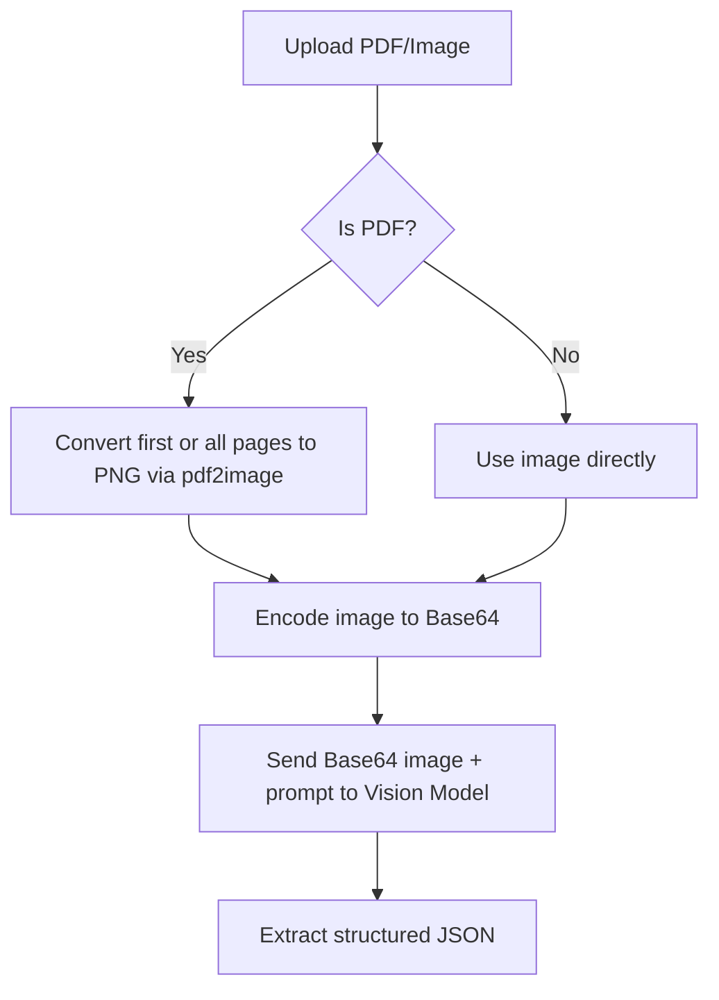
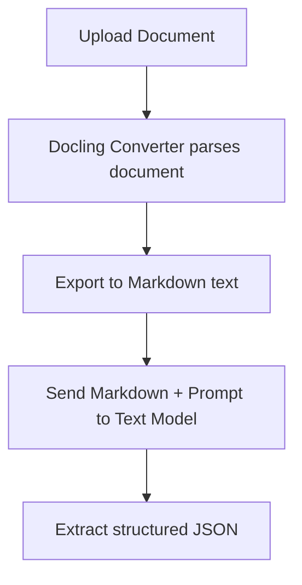

# Invoice & Document Extractor Suite 📄🤖

[](https://github.com/hoangduc102/invoice_extractor/actions/workflows/ci.yml)

A comprehensive suite of Streamlit web applications for extracting structured data from invoices and general documents (PDFs and images) using **LangChain**, **Ollama**, **LangGraph**, and **Docling**.

---

## 📋 Overview

This repository provides a collection of interactive applications designed to demonstrate different architectures for document processing. Whether you want a simple linear extraction workflow, a self-correcting agent that validates its own output, or a schema-configurable extractor that lets you define custom fields on-the-fly, you will find a suitable tool in this suite.

All applications run locally using **Ollama** for privacy and offline capability, supporting both multimodal vision models and text-based parsing.

---

## 🚀 Applications in the Suite

| Application File | Purpose & Focus | LLM Input Type | Key Tech | Unique Features |
| :--- | :--- | :--- | :--- | :--- |
| **`invoice_extractor.py`** *(Main)* | **Self-Correcting Invoice Extractor** | Multimodal (Vision) | LangGraph, ChatOllama | **Self-correction (retries)** when critical fields (Total, Vendor, Date, Inv #) are missing; metrics cards; extraction history stored in the shared database (same table as the REST API). |
| **`extractor_app.py`** | **General Document Extractor** | Text or Multimodal | Docling, ChatOllama | **Dynamic schema editor** (edit & save fields to `field_schema.json`); supports Docling markdown rendering or Multimodal vision; **CSV export**. |
| **`general_app_v2.py`** | **LangGraph General Extractor** | Text or Multimodal | LangGraph, Docling, ChatOllama | Refactored LangGraph implementation of the schema-configurable extractor (`extractor_app.py`). |
| **`docling_app.py`** | **Docling/Multimodal Invoice Extractor** | Text or Multimodal | LangGraph, Docling, ChatOllama | LangGraph-based invoice extractor comparing text-based parsing via Docling vs. vision-based parsing. |
| **`app.py`** | **Basic Invoice Extractor** | Text (PyPDF) or Multimodal | LangGraph, PyPDF, ChatOllama | Basic linear LangGraph pipeline (load -> extract) using `PyPDF` for text parsing. |

---

## 🛠️ Prerequisites

Before running any application, ensure you have the following installed on your system:

### 1. Python 3.12 or later
Check your version with `python --version`.

### 2. Ollama & LLM Models
Download and install Ollama from [ollama.com](https://ollama.com).

Start the Ollama service (`ollama serve`) and pull the models used by the applications:
```bash
# Pull a multimodal vision model (used by invoice_extractor.py & multimodal modes)
ollama pull llava
# or other vision models like
ollama pull qwen3-vl:2b
ollama pull gemma3:4b

# Pull a text-only model (used by Docling / text modes)
ollama pull ministral-3:3b
# or
ollama pull llama3.2
```

### 3. Poppler (System Dependency)
The `pdf2image` library requires **Poppler** to rasterize PDF pages into images for the vision models.
* **Windows**:
  1. Download the latest binary zip from [github.com/oschwartz10612/poppler-windows/releases](https://github.com/oschwartz10612/poppler-windows/releases).
  2. Extract the folder (e.g., to `C:\Program Files\poppler`).
  3. Add the `bin` folder (e.g., `C:\Program Files\poppler\bin`) to your system's environment variable **PATH**.
  4. Restart your terminal/IDE.
* **macOS**:
  ```bash
  brew install poppler
  ```
* **Linux (Ubuntu/Debian)**:
  ```bash
  sudo apt-get update
  sudo apt-get install -y poppler-utils
  ```

---

## 📦 Installation

1. **Clone the repository**:
   ```bash
   git clone https://github.com/hoangduc102/invoice_extractor.git
   cd invoice_extractor
   ```

2. **Install the dependencies**:
   ```bash
   pip install -r requirements.txt
   ```

---

## 🔧 Configuration

### Environment Variables
Copy `.env.example` to `.env` in the root of the project:
```bash
cp .env.example .env
```

Edit the `.env` file to configure your local Ollama connection and defaults:
```ini
# Ollama server URL (default: http://localhost:11434)
OLLAMA_BASE_URL=http://localhost:11434

# Default model to use (default: llava or ministral-3:3b depending on app)
DEFAULT_MODEL=llava
```

---

## 🎯 Running the Applications

Start any app using `streamlit run <filename>`.

### 1. Self-Correcting Invoice Extractor (Main App)
Features UI cards, validation checking, extraction history in the shared database, and self-correction cycles.
```bash
streamlit run invoice_extractor.py
```

### 2. General Document Extractor (Customizable Schema)
Allows you to define what fields to extract inside the UI and export results to CSV.
```bash
streamlit run extractor_app.py
```

### 3. LangGraph General Extractor
Same custom schema flexibility, powered by a LangGraph node-based pipeline.
```bash
streamlit run general_app_v2.py
```

### 4. Docling/Multimodal Invoice Extractor
Uses LangGraph to compare Docling markdown extraction vs. Multimodal vision models.
```bash
streamlit run docling_app.py
```

---

## 🌐 REST API (FastAPI + PostgreSQL)

The self-correcting pipeline is also exposed as a REST API that saves every extraction to a database.
The same LangGraph code (`core/invoice_pipeline.py`) runs behind both the API and the Streamlit app.

### Run with Docker (PostgreSQL + API + Web UI)
```bash
ollama serve                         # on the host
docker compose up db api web --build
# Web UI:     http://localhost:3000
# Swagger UI: http://localhost:8000/docs
```

### Run locally (SQLite, no Docker)
```bash
uvicorn api.main:app --reload        # DATABASE_URL defaults to sqlite:///./invoices.db
```

### Endpoints
| Method | Path | Description |
| :--- | :--- | :--- |
| `GET` | `/health` | Liveness and DB connectivity check |
| `POST` | `/invoices/extract` | Upload a PDF/PNG/JPEG/WEBP (`file`, optional `model_name`), run extraction, persist the result |
| `GET` | `/invoices` | List invoices, newest first. Query params: `vendor` (substring, case-insensitive), `status` (`complete`/`incomplete`), `limit`, `offset` |
| `GET` | `/invoices/stats` | Counts by status and top vendors with summed totals |
| `GET` | `/invoices/{id}` | Full record: all fields, raw LLM output, retry count, missing fields |
| `DELETE` | `/invoices/{id}` | Delete a record |

```bash
curl -F "file=@example_docs/Simple-Invoice-Template.png" -F "model_name=llava" \
     http://localhost:8000/invoices/extract
```

### Data model
The `invoices` table stores the fields people filter on as real columns (`vendor_name`, `invoice_number`,
`currency`, `status`, plus `total_amount NUMERIC(14,2)` parsed from strings like `"$1,234.50"` or `"1.234,50 EUR"`).
The full field set lives in a `JSONB` column. Values the model leaves as `N/A` are stored as `NULL`.

Error handling: unsupported type → `415`, file over 10 MB → `413`, unreadable document → `422`,
Ollama unreachable or model error → `502` (nothing is saved).

---

## 🖥️ Web UI (Next.js)

`frontend/` is a Next.js 16 + TypeScript + Tailwind app on top of the REST API: drag-and-drop upload,
the extracted fields (missing ones highlighted, with the self-correction retry count), and a table of saved
invoices with vendor search, status filter, pagination, a detail view with the raw model output, and delete.

```bash
uvicorn api.main:app --reload            # API on :8000
cd frontend && npm install && npm run dev  # UI on http://localhost:3000
```
Set `NEXT_PUBLIC_API_URL` if the API is not on `localhost:8000`, and `CORS_ORIGINS` on the API if the UI is not on `localhost:3000`.

---

## 📊 Accuracy Evaluation

LLM output is non-deterministic, so "it works on my invoice" is not evidence. `evaluation/` measures it:

* `evaluation/ground_truth.json`: 12 invoices from `example_docs/`, labelled by hand (bank statements excluded).
  Fields that are *not* on a document are labelled `null`, so an invented value counts as a **hallucination**.
* `evaluation/scoring.py` normalizes before comparing: amounts numerically (`"$6,950.00"` = `6950`),
  dates in any format (`"23.05.2021"` = `"May 23, 2021"`), invoice numbers on alphanumerics, names by fuzzy match.
* Each run records the **first-pass** answer and the **final** answer after the LangGraph retry loop,
  so the report shows how much self-correction actually helps. `--runs N` also measures run-to-run consistency.

```bash
ollama pull llava
python -m evaluation.evaluate --model llava --runs 3 --update-readme
python -m evaluation.evaluate --model llava --model qwen3-vl:2b          # compare models side by side
python -m evaluation.evaluate --rescore evaluation/results/*.json        # re-score saved runs, no LLM calls
```
Raw predictions are saved to `evaluation/results/` so every number below can be re-checked.

### Results
<!-- EVAL:START -->
_Not run yet. Start Ollama, then run `python -m evaluation.evaluate --model llava --runs 3 --update-readme` to fill in this table._
<!-- EVAL:END -->

---

## ✅ Tests & CI

```bash
pip install -r requirements-ci.txt
ruff check . && ruff format --check .
pytest -q
```
The tests replace the LLM with a fake and use in-memory SQLite, so they need neither Ollama nor PostgreSQL.
They cover the pipeline helpers, the API endpoints, the shared repository, the evaluation scoring, and a Streamlit
smoke test (`streamlit.testing.AppTest`) that checks the History tab reads from the database.

GitHub Actions (`.github/workflows/ci.yml`) runs on every push and pull request:
| Job | What it checks |
| :--- | :--- |
| Backend | `ruff check`, `ruff format --check`, `pytest` |
| API against PostgreSQL | Starts the API on a real `postgres:16` service container, hits `/health`, `/invoices`, `/invoices/stats`, and checks extraction fails cleanly (502, nothing saved) when no LLM is available |
| Frontend | `eslint`, `tsc --noEmit`, `next build` |

---

## 📂 Project Structure

```
Invoice_Extractor/
├── .github/workflows/ci.yml # Lint, tests, Postgres integration check, frontend build
├── api/                 # FastAPI app: routes (main.py), models, schemas, DB session, repository
├── core/
│   └── invoice_pipeline.py # Shared LangGraph self-correcting pipeline (no UI code)
├── evaluation/          # Ground truth, scoring, accuracy report script, saved results
├── frontend/            # Next.js web UI (upload + results table)
├── tests/               # pytest: pipeline, API, repository, scoring, Streamlit smoke test
├── docker-compose.yml   # PostgreSQL + API + web UI + all Streamlit apps
├── pyproject.toml       # ruff + pytest config
├── requirements-ci.txt  # Lightweight deps for tests/lint (no docling/torch)
├── .streamlit/
│   └── config.toml      # Custom Slate Dark theme settings for Streamlit
├── example_docs/        # Sample PDFs, images, and statements for testing
│   ├── Downloadable-PDF-Invoices-Add-On-Samples.pdf
│   ├── Simple-Invoice-Template.png
│   ├── Simple-Invoice-Template.webp
│   ├── Simple-Invoice-Template-2x.jpeg
│   ├── Bank-of-America-Statement-BankStatements-net.pdf
│   ├── chase-bank-statement-template-1-1.pdf
│   ├── hourly_invoice_template.png
│   ├── invoice-0-4.pdf
│   ├── invoice-1-3.pdf
│   ├── invoice-2-1.pdf
│   ├── invoice-3-0.pdf
│   ├── invoice-7-0.pdf
│   ├── novelty-bank-statement.webp
│   └── wordpress-pdf-invoice-plugin-sample.pdf
├── .env                # Configured environment variables (Ollama URL, default model)
├── .env.example        # Example environment template
├── .gitignore          # Git ignore patterns
├── AGENTS.md           # LLM agent instructions & guidelines
├── LICENSE             # MIT License
├── app.py              # Basic LangGraph invoice extractor using PyPDF
├── docling_app.py      # LangGraph invoice extractor supporting Docling / Multimodal
├── extractor_app.py    # General Document Extractor with dynamic schema and CSV export
├── field_schema.json   # Schema definitions saved by the general extractors
├── general_app_v2.py   # LangGraph version of the schema-configurable extractor
├── invoice_extractor.py # Main self-correcting invoice extractor with history & metrics
├── requirements.txt    # Required python dependencies (includes streamlit, docling, langgraph, etc.)
└── README.md           # This documentation
```

---

## 🔍 Technical Details & Modes

### 1. Multimodal (Vision) Mode
In this mode, the document (image or PDF) is converted page-by-page (using `pdf2image`) to images. The images are encoded in base64 format and sent directly to Ollama vision-capable models (like `llava` or `qwen3-vl:2b`). This is best for complex, highly-visual invoice templates, bank statements, or tables.



### 2. Docling + Text LLM Mode
In this mode, the application uses IBM's **Docling** library to parse files (PDFs, DOCX, Images, etc.) and extract their structured content as Markdown. This markdown text is then sent to a standard text LLM (like `ministral-3:3b` or `llama3.2`). This is ideal for text-dense documents, contracts, or when running lighter LLM models that lack vision capabilities.



---

## 🐛 Troubleshooting

### 1. `pdf2image.exceptions.PDFInfoNotInstalledError` / Poppler not found
This happens when `poppler` is missing or not configured in your system's PATH.
* Refer to the **Prerequisites -> Poppler** instructions above.
* Ensure you restarted your IDE or terminal session after updating your environment variables.

### 2. Ollama Connection Error (`ConnectionRefusedError`)
* Make sure the Ollama application is running (`ollama serve`).
* Double-check your `.env` file matches the port where Ollama is listening (typically `http://localhost:11434`).

### 3. Model Not Found
If you see an error indicating that the model cannot be found:
* Verify the model has been downloaded using `ollama list`.
* If it's missing, download it via command line: e.g., `ollama pull llava` or `ollama pull ministral-3:3b`.

### 4. Custom Streamlit Port
If port `8501` is already in use, you can launch Streamlit on a different port:
```bash
streamlit run invoice_extractor.py --server.port 8502
```

---

## 📄 License

This project is licensed under the MIT License - see the [LICENSE](LICENSE) file for details.
